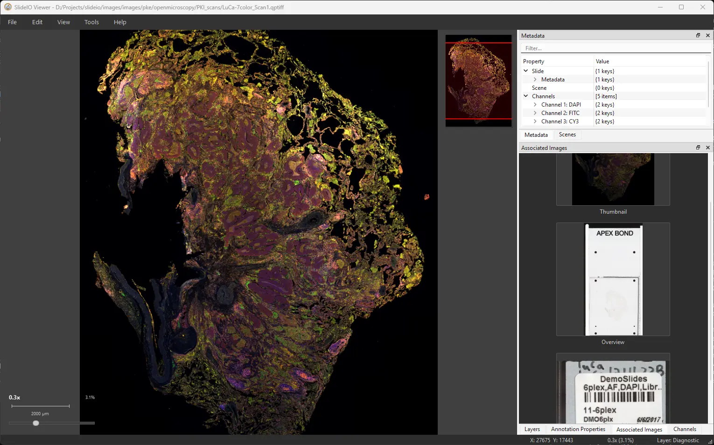

# SlideIO Viewer

SlideIO Viewer is a free, open-source desktop application for viewing and
annotating whole-slide images. It opens a gigapixel slide in a window and lets
you pan and zoom through it at interactive speed, without converting it or
loading it into memory first. You can outline regions, count cells, measure
distances and angles, and export the results for QuPath or a spreadsheet.

The viewer is built on the SlideIO library, so it reads every format the
library supports, and it runs on Windows, macOS and Linux.



## Features

- **GPU-accelerated rendering.** Tiles are drawn with OpenGL, so panning and
  zooming stay smooth on slides of any size.
- **Pyramid navigation.** The viewer reads from the zoom pyramid stored in the
  slide and loads tiles in the background.
- **Minimap, zoom indicator and scale bar** for orientation at any
  magnification.
- **Scenes, associated images, properties and metadata** of the slide, each in
  its own pane.
- **Channels.** Per-channel visibility, colour, intensity and display range
  with a histogram, for fluorescence and multiplexed slides.
- **Z-stacks and time series.** Step through the Z and T planes of 3D and
  time-lapse data sets.
- **Colour management.** Display RGB slides through their ICC profile.
- **Annotations.** Rectangles, ellipses, polygons, freehand lines, point
  markers, arrows and text, organised in layers and classified by category.
- **Measurements.** Rulers and angles on the slide; area, perimeter and length
  of every shape, in microns when the slide is calibrated.
- **Import and export.** GeoJSON (QuPath) and ASAP XML import, GeoJSON export,
  and CSV exports of counts and measurements.

## Supported formats

The viewer reads every format the SlideIO library supports: Aperio SVS and AFI,
Leica SCN, Zeiss CZI and ZVI, Hamamatsu NDPI, Olympus VSI, DICOM whole-slide
images, PerkinElmer QPTIFF, OME-TIFF, Philips TIFF, and ordinary TIFF, PNG and
JPEG images. See [Image drivers](../drivers.md) for the file extensions.

## Contents

```{toctree}
:maxdepth: 2

install
window
opening-slides
navigation
panes
channels
color-management
annotations/index
shortcuts
troubleshooting
```

## Source code

The viewer is developed in the open at
[github.com/Booritas/slideio-view](https://github.com/Booritas/slideio-view)
under the same BSD 3-clause license as the library. It is a C++17 Qt 6
application built with CMake and Conan; the repository's README describes how
to build it from source.
